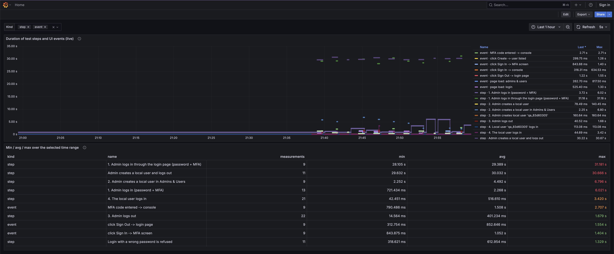

# UniFi OS Server: local user login tests

Automated tests for a self-hosted **UniFi OS Server**, covering one scenario on two levels:

1. Admin logs in (UI account, password + MFA)
2. Admin creates a new **local** user account
3. Admin logs out
4. The new local user logs in

| Level | Tooling | Test |
|---|---|---|
| REST API | `pytest` + `requests` | `tests/api/test_local_user_login.py` |
| End-to-end UI | `pytest` + Playwright (Python) | `tests/e2e/test_local_user_login_ui.py` |

Both levels share one runner, one configuration and one report, so there is a single command to run everything.

## Quick start

```bash
make install            # venv + dependencies + Chromium for Playwright
cp .env.example .env    # then fill in URL, admin credentials and TOTP secret
make test               # API + E2E
open reports/report.html
```

Without `make`:

```bash
python3 -m venv .venv && source .venv/bin/activate
pip install -e ".[dev]" && playwright install chromium
pytest                  # everything
pytest -m api           # REST API only (about a minute with MFA)
pytest -m e2e           # Playwright only
pytest -m e2e --headed --slowmo 300   # watch the browser
```

Requirements: Python 3.11+, a running UniFi OS Server reachable from the machine running the tests.

## Task #1: environment (UniFi OS Server 5.1.42)

The server was deployed locally on macOS from the official build
`UniFi OS Server 5.1.42` - `https://fw-update.ui.com/api/firmware-latest?filter=eq~~product~~unifi-os-server`.

1. Open the `.dmg`, drag **UniFi OS Server** to Applications.
2. Open `https://localhost:11443` and accept the self-signed certificate.
3. Name the server. To link it to a **UI account** (account.ui.com): Settings > UniFi OS Server >
   Control Plane > Console > tick **Remote Access** and sign in with the UI account.
4. On account.ui.com > Security, enable **MFA with an authenticator app**. While the QR code is shown,
   choose "can't scan?" and copy the text secret: that is `UNIFI_ADMIN_TOTP_SECRET`
   (password managers such as 1Password also show it in the one-time password field).
   The tests compute the 6-digit code from it, so MFA stays on and the suite still runs unattended.

## Configuration

All settings come from environment variables or a git-ignored `.env` file (see `.env.example`):

| Variable | Description |
|---|---|
| `UNIFI_BASE_URL` | e.g. `https://localhost:11443` |
| `UNIFI_ADMIN_USERNAME` / `UNIFI_ADMIN_PASSWORD` | owner (UI account) credentials |
| `UNIFI_ADMIN_TOTP_SECRET` | base32 authenticator secret for MFA |
| `UNIFI_LOCAL_USER_PASSWORD` | optional, otherwise a strong random password per user |
| `UNIFI_VERIFY_TLS` | `false` for the default self-signed certificate |
| `UNIFI_RECORD_HAR` | optional, `1` records the UI's API calls to `reports/network.har` |
| `UNIFI_PUSHGATEWAY_URL` | optional, e.g. `http://localhost:9091` sends live metrics to the monitoring stack |

A missing variable stops the run immediately with a message that names it.

## Live metrics in Grafana (optional)

The tests can stream timings to a local Prometheus + Grafana stack while they run:

```bash
make monitoring-up      # Docker: Pushgateway :9091, Prometheus :9090, Grafana :3000
make test-live          # same as make test, with UNIFI_PUSHGATEWAY_URL=http://localhost:9091
open http://localhost:3000
make monitoring-down
```

What is measured (metric `unifi_test_duration_seconds`, label `kind`):

| kind | Examples |
|---|---|
| `step` | every named test step, e.g. `3. Admin logs out` |
| `event` | UI performance: `page load: login` (Navigation Timing), `click Sign In -> MFA screen`, `MFA code entered -> console`, `click Create -> user listed`, `click Sign Out -> login page` |
| `api` | every REST call, e.g. `POST /api/auth/login`, `DELETE /proxy/users/api/v2/user/{id}` |



The dashboard "UniFi OS tests" shows the durations live and a table with min / avg / max per name
over the selected time range. Without `UNIFI_PUSHGATEWAY_URL` nothing is sent and the tests run as usual;
the timings are still printed in the log and the HTML report.

## Smoke run

```bash
caffeinate -i bash -c 'end=$((SECONDS+1800)); n=0; while [ $SECONDS -lt $end ]; do n=$((n+1)); echo "=== run $n ==="; make test-live; sleep 15; done'
```

## Lint

```bash
make lint   # ruff check + ruff format --check
```
